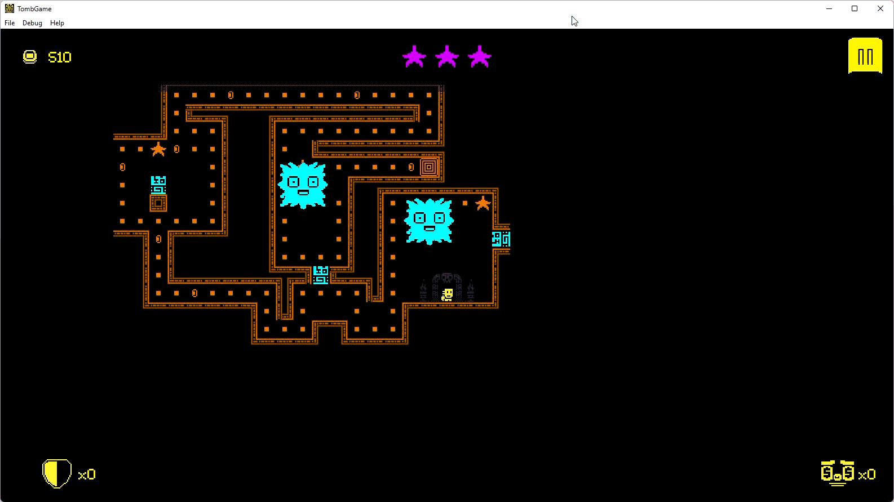
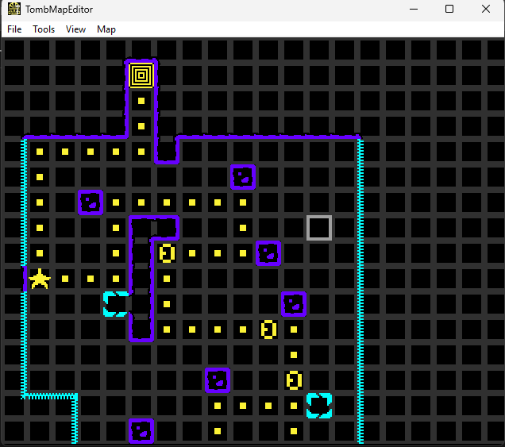

# Tomb of the Mask

A Windows clone of **Tomb of the Mask**, built in **C++ without a game engine**. The game uses the **Win32 API** for windowing and input, **GDI** for rendering, **SQLite** for saving progress, and **JSON** for level data. The project also includes a custom map editor.

## Za projekat koristeno

- **CODE::BLOCKS** 25.04 (po zahtjevu profesora)
- **Game:** C++ 11
- **Editor:** C++ 14
- **Windowing and input:** Win32 API
- **Rendering:** Windows GDI
- **Progress storage:** SQLite
- **Level data:** JSON (nlohmann/json)
